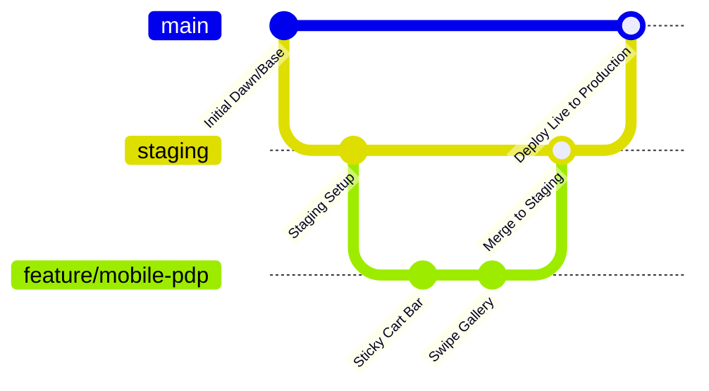
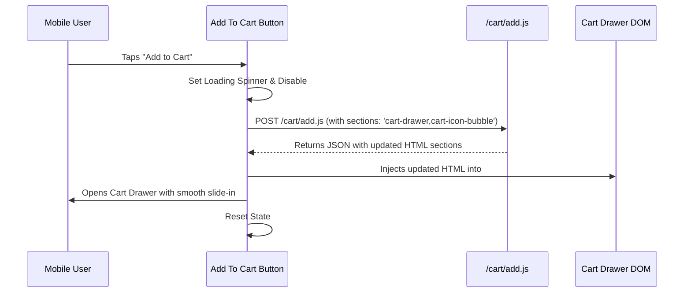

# ⚡ SHOPIFY STORE AGENT PLAYBOOK
## The GitHub Method, Mobile-First Architecture & OS 2.0 Standard Operating Procedure

> **Agent Directive:** This document is the single source of truth for AI agents and developers building production-grade Shopify stores. When instructed to build or modify any Shopify storefront, you MUST follow the architectural patterns, directory structures, mobile-first UX guidelines, and GitHub deployment workflows detailed here.

---

## Table of Contents
1. [The GitHub Method (Deployment & Version Control)](#1-the-github-method)
2. [Online Store 2.0 File & Directory Structure](#2-online-store-20-file--directory-structure)
3. [Mobile-First UX & Thumb Zone Ergonomics](#3-mobile-first-ux--thumb-zone-ergonomics)
4. [Section Schema & Liquid Engineering Standards](#4-section-schema--liquid-engineering-standards)
5. [AJAX Cart & Section Rendering API Architecture](#5-ajax-cart--section-rendering-api-architecture)
6. [Design System, CSS Tokens & Visual Standards](#6-design-system-css-tokens--visual-standards)
7. [Shopify Data Modeling: Tags, Variants & Metafields](#7-shopify-data-modeling-tags-variants--metafields)
8. [Performance, Core Web Vitals & Technical SEO](#8-performance-core-web-vitals--technical-seo)
9. [Alternative Architecture: Headless (Next.js + Storefront API)](#9-alternative-architecture-headless-nextjs--storefront-api)
10. [End-to-End Agent Execution Checklist](#10-end-to-end-agent-execution-checklist)

---

## 1. The GitHub Method

Shopify natively connects to GitHub repositories via the Shopify Theme GitHub Integration. This enables continuous integration, branch previews, and version-controlled theme deployments directly inside the Shopify Admin.

### 1.1 Branch Architecture

Every Shopify store repository MUST follow this three-tier branch hierarchy:



| Branch Name | Shopify Theme Connection | Purpose | Access Level |
| :--- | :--- | :--- | :--- |
| `main` | **Published / Live Theme** | Production store seen by customers. Automated deployment on push. | Protected. Requires PR + QA pass. |
| `staging` | **Unpublished Preview Theme** (e.g. `[QA] Staging Theme`) | Full-store acceptance testing, merchant client review, integration testing. | Developers & Agents merge here first. |
| `feature/*` | **Development Theme / Preview** (e.g. `shopify theme dev`) | Active agent work branch. Linked via Shopify CLI or unpublished branch theme. | Agent/Dev sandbox. |

---

### 1.2 Connecting GitHub to Shopify Admin

1. In Shopify Admin, navigate to: **Online Store** → **Themes**.
2. Under **Theme library**, click **Add theme** → **Connect from GitHub**.
3. Authenticate with GitHub and select your repository:
   - Connect `main` → Rename to `Production [Live]`.
   - Connect `staging` → Rename to `Staging [QA]`.
4. Once verified, publish `main` as the active theme.

---

### 1.3 The Two-Way Sync Conflict (CRITICAL AGENT RULE)

> [!CAUTION]
> **Shopify Admin Theme Editor commits directly to GitHub!**
> When a merchant adjusts section settings, rearranges blocks, or adds content via the visual Theme Customizer (`/admin/themes/<id>/editor`), Shopify automatically creates commits on the connected GitHub branch, modifying files in `templates/*.json` and `config/settings_data.json`.

#### Non-Negotiable Agent Workflow to Prevent Overwrites:
1. **Always Pull Before Working:**
   ```bash
   git checkout staging
   git pull origin staging
   ```
2. **Never Overwrite Merchant JSON Without Merging:**
   Never overwrite `config/settings_data.json` or `templates/*.json` blindly with local dummy files. Always retain merchant data blocks and settings.
3. **Use Shopify CLI for Local Theme Dev:**
   ```bash
   # Run local dev server linked to the store
   shopify theme dev --store=your-store.myshopify.com

   # Pull live merchant customizer changes down to local git
   shopify theme pull --store=your-store.myshopify.com --theme=<theme-id>
   ```

---

### 1.4 Production-Grade `.gitignore` for Shopify Theme Repositories

```gitignore
# Shopify CLI temporary files
.shopify/
*.tmp
*.log

# OS & Editor files
.DS_Store
Thumbs.db
.vscode/
.idea/

# Node / Build artifacts (if using SCSS/Tailwind/Vite build steps)
node_modules/
dist/
.cache/

# Local credentials
.env
.env.local
.env.*.local
shopify.theme.env

# Theme packaged zip files
*.zip
```

---

## 2. Online Store 2.0 File & Directory Structure

All themes must conform to the official Shopify Online Store 2.0 standard. All templates MUST be JSON-first (`.json`), not legacy `.liquid` templates, enabling merchants to add, remove, and reorder sections natively in the theme editor.

### 2.1 Complete Theme Directory Tree

```
shopify-theme/
├── assets/                       # Static assets (CSS, JS, SVGs, Fonts)
│   ├── base.css                  # Core design tokens, resets, typography
│   ├── component-cart-drawer.css # Cart drawer styles
│   ├── component-product.css     # PDP & mobile sticky bar styles
│   ├── global.js                 # Shared utilities, PubSub, Ajax cart helpers
│   ├── cart-drawer.js            # Web component / controller for cart drawer
│   └── icons.svg                 # SVG sprite sheet or inline snippet equivalents
│
├── config/                       # Merchant global settings schema & values
│   ├── settings_schema.json      # Customizer controls (Colors, Typography, Brand)
│   └── settings_data.json        # Saved merchant settings (auto-updated by Shopify)
│
├── layout/                       # Outer HTML wrappers
│   ├── theme.liquid              # Master document (<head>, header, main, footer)
│   └── password.liquid           # Password page layout
│
├── locales/                      # Internationalization / i18n
│   ├── en.default.json           # Default English copy strings
│   └── fr.json                   # Additional languages if required
│
├── sections/                     # Dynamic & reorderable page sections
│   ├── header.liquid             # Sticky header + mobile hamburger drawer
│   ├── footer.liquid             # Mobile accordion footer
│   ├── main-product.liquid       # Mobile-first PDP with sticky CTA
│   ├── main-collection.liquid    # Product grid + mobile filter bottom-sheet
│   ├── hero-banner.liquid        # Video/image hero with responsive text
│   ├── featured-products.liquid  # Scroll-snap swipeable product carousel
│   └── cart-drawer.liquid        # AJAX slide-over cart drawer section
│
├── snippets/                     # Reusable micro-components (partials)
│   ├── product-card.liquid       # Standard product item card
│   ├── price.liquid              # Consistent price, currency, & sale badge
│   ├── icon-cart.liquid          # Clean SVG icons
│   ├── icon-hamburger.liquid     # Mobile menu trigger icon
│   ├── icon-close.liquid         # Accessible modal/drawer close icon
│   └── meta-tags.liquid          # SEO, Open Graph, & Twitter Card tags
│
└── templates/                    # JSON-first page architectures
    ├── index.json                # Home page section configuration
    ├── product.json              # Product detail page layout
    ├── collection.json           # Collection listing page layout
    ├── cart.json                 # Fallback cart page (for no-JS)
    ├── page.json                 # Standard CMS page
    ├── 404.json                  # 404 error page
    └── customers/                # Account templates
        ├── login.json
        ├── register.json
        └── account.json
```

---

### 2.2 Deep Dive: JSON Templates vs Legacy Liquid Templates

> [!IMPORTANT]
> **Why JSON Templates?**
> In OS 2.0, `templates/product.json` defines which sections appear on the page and in what order. The actual HTML/Liquid markup resides inside `sections/main-product.liquid` and modular blocks.

#### Example: `templates/product.json`
```json
{
  "name": "Default Product",
  "wrapper": "div.product-page-wrapper",
  "sections": {
    "main": {
      "type": "main-product",
      "blocks": {
        "vendor": {
          "type": "text",
          "settings": { "text": "{{ product.vendor }}" }
        },
        "title": {
          "type": "title",
          "settings": {}
        },
        "price": {
          "type": "price",
          "settings": {}
        },
        "variant_picker": {
          "type": "variant_picker",
          "settings": { "picker_type": "button" }
        },
        "buy_buttons": {
          "type": "buy_buttons",
          "settings": {
            "show_dynamic_checkout": true,
            "show_sticky_mobile_bar": true
          }
        },
        "description": {
          "type": "description",
          "settings": {}
        }
      },
      "block_order": [
        "vendor",
        "title",
        "price",
        "variant_picker",
        "buy_buttons",
        "description"
      ],
      "settings": {
        "enable_sticky_info": true,
        "gallery_layout": "scroll-snap"
      }
    },
    "recommendations": {
      "type": "featured-products",
      "settings": {
        "title": "You May Also Like",
        "products_to_show": 4
      }
    }
  },
  "order": ["main", "recommendations"]
}
```

---

## 3. Mobile-First UX & Thumb Zone Ergonomics

Over 75% of e-commerce traffic originates from mobile smartphones. Designing desktop-first and shrinking to mobile is strictly prohibited. **All stores must be designed from 320px / 375px upward.**

### 3.1 Thumb Zone Mapping

```
+---------------------------+
|      TOP 20% OF SCREEN    |  -> Hard Reach (Logo, Search Icon, Badges)
+---------------------------+
|                           |
|      MIDDLE 50% OF SCREEN |  -> Natural Reach (Image Carousel, Details, Specs)
|                           |
+---------------------------+
|                           |
|      BOTTOM 30% OF SCREEN |  -> PRIMARY THUMB ACTION ZONE
|                           |  -> Sticky CTA, Quantity, Filter Triggers, Cart Checkout
+---------------------------+
```

---

### 3.2 Non-Negotiable Mobile Standards

1. **Tap Target Sizes:**
   - All interactive controls (buttons, variant chips, links, drawer toggles) MUST have a minimum bounding box of **44 × 44px** (ideally 48 × 48px).
   - Minimum **8px margin** between adjacent clickable targets to eliminate fat-finger errors.
2. **Input Font Size (iOS Auto-Zoom Prevention):**
   - All `<input>`, `<select>`, and `<textarea>` elements MUST use `font-size: 16px` or greater on screens `< 768px`. Any size below 16px triggers automatic, disorienting iOS Safari viewport zooming.
3. **Viewport & Safe Area Insets:**
   - Must support modern edge-to-edge screens (iPhone notch & dynamic island, home indicator bar):
     ```html
     <meta name="viewport" content="width=device-width, initial-scale=1.0, maximum-scale=5.0, viewport-fit=cover">
     ```
   - In CSS, apply environment safe-area padding:
     ```css
     .sticky-mobile-bar {
       padding-bottom: calc(12px + env(safe-area-inset-bottom, 0px));
     }
     ```

---

### 3.3 Sticky Mobile Action Bar (PDP)

Every product page MUST include a persistent, sticky bottom purchase bar on mobile viewports. It anchors the primary CTA directly under the user's thumb once they scroll past the in-page buy button.

#### Complete Implementation (`snippets/sticky-mobile-bar.liquid`):
```liquid

  Renders the mobile sticky Add to Cart bar.
  Accepts:
  - product: {Object} Product Liquid object
  - current_variant: {Object} Selected variant


<div id="StickyMobileBar" class="sticky-mobile-bar" data-product-handle="{{ product.handle }}">
  <div class="sticky-mobile-bar__content">
    <div class="sticky-mobile-bar__details">
      <span class="sticky-mobile-bar__title">{{ product.title | truncate: 25 }}</span>
      <div class="sticky-mobile-bar__price" id="StickyBarPrice">
        <span class="price-current">{{ current_variant.price | money }}</span>
        
          <s class="price-compare">{{ current_variant.compare_at_price | money }}</s>
        
      </div>
    </div>
    
    <button 
      type="button" 
      id="StickyBarButton"
      class="button button--primary sticky-mobile-bar__cta"
      disabled
      onclick="document.getElementById('ProductSubmitButton').click();"
    >
      <span class="cta-text">
        
          {{ 'products.product.add_to_cart' | t | default: 'Add to Cart' }}
        
          {{ 'products.product.sold_out' | t | default: 'Sold Out' }}
        
      </span>
    </button>
  </div>
</div>
```

#### Accompanying Mobile CSS (`assets/component-product.css`):
```css
/* Mobile-First: Visible by default on small viewports */
.sticky-mobile-bar {
  position: fixed;
  bottom: 0;
  left: 0;
  right: 0;
  z-index: 99;
  background: rgba(11, 27, 58, 0.95);
  backdrop-filter: blur(12px);
  -webkit-backdrop-filter: blur(12px);
  border-top: 1px solid rgba(255, 255, 255, 0.1);
  padding: 10px 16px calc(10px + env(safe-area-inset-bottom, 0px)) 16px;
  transform: translateY(100%);
  transition: transform 0.3s cubic-bezier(0.16, 1, 0.3, 1);
  box-shadow: 0 -4px 20px rgba(0, 0, 0, 0.3);
}

/* Active class toggled by IntersectionObserver */
.sticky-mobile-bar.is-visible {
  transform: translateY(0);
}

.sticky-mobile-bar__content {
  display: flex;
  align-items: center;
  justify-content: space-between;
  gap: 12px;
  max-width: 600px;
  margin: 0 auto;
}

.sticky-mobile-bar__details {
  display: flex;
  flex-direction: column;
  min-width: 0;
}

.sticky-mobile-bar__title {
  font-size: 13px;
  font-weight: 600;
  color: #FFFFFF;
  white-space: nowrap;
  overflow: hidden;
  text-overflow: ellipsis;
}

.sticky-mobile-bar__price {
  font-size: 15px;
  font-weight: 700;
  color: #1E6FEF;
}

.sticky-mobile-bar__cta {
  min-height: 48px;
  min-width: 140px;
  padding: 0 20px;
  border-radius: 8px;
  font-size: 15px;
  font-weight: 700;
  white-space: nowrap;
  touch-action: manipulation;
}

/* Hide on Desktop Viewports */
@media screen and (min-width: 990px) {
  .sticky-mobile-bar {
    display: none !important;
  }
}
```

#### IntersectionObserver Controller (`assets/product-sticky-bar.js`):
```javascript
document.addEventListener('DOMContentLoaded', () => {
  const mainBuyBtn = document.getElementById('ProductSubmitButton');
  const stickyBar = document.getElementById('StickyMobileBar');

  if (!mainBuyBtn || !stickyBar) return;

  const observer = new IntersectionObserver((entries) => {
    entries.forEach(entry => {
      // If the main buy button has scrolled out of view, show sticky bar
      if (!entry.isIntersecting && entry.boundingClientRect.top < 0) {
        stickyBar.classList.add('is-visible');
      } else {
        stickyBar.classList.remove('is-visible');
      }
    });
  }, { threshold: 0.1 });

  observer.observe(mainBuyBtn);
});
```

---

### 3.4 Native Touch Swiping via CSS Scroll Snap

Avoid heavy 3rd-party slider libraries (like Swiper or Slick) that bloat bundle sizes and drop frame rates on mobile. Use **native hardware-accelerated CSS Scroll Snap**:

```html
<div class="product-gallery__slider">
  
    <div class="product-gallery__slide" id="Slide-{{ forloop.index }}">
      {{ image | image_url: width: 750 | image_tag: 
         loading: forloop.first ? 'eager' : 'lazy',
         fetchpriority: forloop.first ? 'high' : 'auto',
         widths: '375, 550, 750',
         sizes: '(max-width: 768px) 100vw, 50vw',
         alt: image.alt | escape 
      }}
    </div>
  
</div>
```

```css
.product-gallery__slider {
  display: flex;
  overflow-x: auto;
  scroll-snap-type: x mandatory;
  -webkit-overflow-scrolling: touch;
  scrollbar-width: none; /* Firefox */
  gap: 12px;
}

.product-gallery__slider::-webkit-scrollbar {
  display: none; /* Chrome, Safari */
}

.product-gallery__slide {
  flex: 0 0 100%;
  scroll-snap-align: start;
  scroll-snap-stop: always;
  position: relative;
  aspect-ratio: 1 / 1;
}

.product-gallery__slide img {
  width: 100%;
  height: 100%;
  object-fit: cover;
  border-radius: 12px;
}
```

---

## 4. Section Schema & Liquid Engineering Standards

### 4.1 Modular Section Schema Best Practices

Every section MUST expose a clean `schema` tag so merchants can configure spacing, colors, text, and blocks via the Shopify Theme Editor without writing code.

#### Canonical Section Example (`sections/featured-products.liquid`):
```liquid

  Featured Products Carousel Section
  Fully responsive with native CSS scroll snap and JSON Schema controls.


{{ 'section-featured-products.css' | asset_url | stylesheet_tag }}

<section class="section-featured-products color-{{ section.settings.color_scheme }}" id="Section-{{ section.id }}">
  <div class="page-width">
    <div class="section-header">
      <h2 class="section-title">{{ section.settings.heading | escape }}</h2>
      
        <p class="section-subtitle">{{ section.settings.subheading | escape }}</p>
      
    </div>

    <div class="product-scroll-grid">
      
      
        <div class="product-scroll-grid__item">
          
        </div>
      
        
          <div class="product-scroll-grid__item placeholder">
            {{ 'product-' | append: i | placeholder_svg_tag: 'placeholder-svg' }}
          </div>
        
      
    </div>
  </div>
</section>


{
  "name": "Featured Products",
  "tag": "section",
  "class": "spaced-section",
  "settings": [
    {
      "type": "text",
      "id": "heading",
      "default": "Featured Collection",
      "label": "Section Heading"
    },
    {
      "type": "text",
      "id": "subheading",
      "label": "Subheading"
    },
    {
      "type": "collection",
      "id": "collection",
      "label": "Collection"
    },
    {
      "type": "range",
      "id": "products_to_show",
      "min": 2,
      "max": 12,
      "step": 1,
      "default": 4,
      "label": "Maximum products to show"
    },
    {
      "type": "select",
      "id": "color_scheme",
      "options": [
        { "value": "primary", "label": "Dark Navy" },
        { "value": "secondary", "label": "Deep Charcoal" },
        { "value": "accent", "label": "Cobalt Accent" }
      ],
      "default": "primary",
      "label": "Color Scheme"
    },
    {
      "type": "checkbox",
      "id": "show_vendor",
      "default": false,
      "label": "Show Product Vendor"
    }
  ],
  "presets": [
    {
      "name": "Featured Products",
      "settings": {
        "heading": "Top Recommended Batteries"
      }
    }
  ]
}

```

---

### 4.2 Liquid Coding Rules for Agents

1. **Never Hardcode Text:**
   Always use Shopify translation keys: `{{ 'products.product.add_to_cart' | t }}` or configurable schema settings with sane defaults.
2. **Never Use Unbounded Loops:**
   Always specify a `limit:` on `for` loops to prevent severe page performance degradation.
3. **Always Escape User Input:**
   Use `| escape` on headings and titles to prevent XSS.
4. **Use `render` Instead of `include`:**
   `include` is deprecated. Always use `` which enforces isolated variable scope and boosts compilation performance.

---

## 5. AJAX Cart & Section Rendering API Architecture

Do not redirect users to the cart page (`/cart`) upon clicking "Add to Cart". High-converting mobile stores must open a slide-over **AJAX Cart Drawer** instantly.

### 5.1 Shopify Section Rendering API Workflow



---

### 5.2 Implementation of Section-Rendered AJAX Add

```javascript
/**
 * Global Cart Controller using Shopify Section Rendering API
 */
async function addToCart(formElement) {
  const submitButton = formElement.querySelector('[type="submit"]');
  submitButton.setAttribute('aria-busy', 'true');
  submitButton.classList.add('loading');

  const formData = new FormData(formElement);
  
  // Request the updated HTML for the cart drawer and badge sections
  formData.append('sections', 'cart-drawer,cart-icon-bubble');
  formData.append('sections_url', window.location.pathname);

  try {
    const response = await fetch('/cart/add.js', {
      method: 'POST',
      headers: {
        'Accept': 'application/javascript',
        'X-Requested-With': 'XMLHttpRequest'
      },
      body: formData
    });

    const data = await response.json();

    if (response.ok) {
      // 1. Update the Cart Drawer DOM with newly rendered section HTML
      const cartDrawerContainer = document.getElementById('CartDrawer');
      if (cartDrawerContainer && data.sections['cart-drawer']) {
        const parsedHtml = new DOMParser().parseFromString(data.sections['cart-drawer'], 'text/html');
        cartDrawerContainer.innerHTML = parsedHtml.getElementById('CartDrawer').innerHTML;
      }

      // 2. Update Header Cart Count Badge
      const cartBadge = document.getElementById('CartIconBubble');
      if (cartBadge && data.sections['cart-icon-bubble']) {
        const parsedBadge = new DOMParser().parseFromString(data.sections['cart-icon-bubble'], 'text/html');
        cartBadge.innerHTML = parsedBadge.getElementById('CartIconBubble').innerHTML;
      }

      // 3. Open the Cart Drawer
      openCartDrawer();
    } else {
      console.error('Cart Add Error:', data.description);
      alert(data.description || 'Unable to add item to cart.');
    }
  } catch (error) {
    console.error('Fetch Exception:', error);
  } finally {
    submitButton.removeAttribute('aria-busy');
    submitButton.classList.remove('loading');
  }
}

function openCartDrawer() {
  const drawer = document.getElementById('CartDrawer');
  const overlay = document.getElementById('CartDrawerOverlay');
  if (drawer && overlay) {
    drawer.classList.add('is-open');
    overlay.classList.add('is-visible');
    document.body.classList.add('overflow-hidden');
  }
}
```

---

## 6. Design System, CSS Tokens & Visual Standards

A generic-looking store is an automatic failure. All Shopify stores developed under this protocol must implement a curated, high-contrast, modern aesthetic with fluid typography and micro-interactions.

### 6.1 Design Tokens (`assets/base.css`)

```css
:root {
  /* Surface Colors */
  --color-bg-primary: #0B1B3A;        /* Deep Navy Canvas */
  --color-bg-secondary: #132448;      /* Elevated Card Surface */
  --color-bg-elevated: #1B2F5C;       /* Modals & Bottom Sheets */
  --color-border: rgba(255, 255, 255, 0.12);
  
  /* Brand Energy & Accents */
  --color-primary-accent: #1E6FEF;    /* Cobalt Blue Energy */
  --color-primary-hover: #1555BD;
  --color-critical-cta: #E4291B;      /* Critical Action Red (Add to Cart / Buy Now) */
  --color-critical-hover: #C52014;
  --color-success: #10B981;
  --color-warning: #F59E0B;

  /* Typography Colors */
  --color-text-primary: #FFFFFF;
  --color-text-secondary: #94A3B8;    /* Muted Slate */
  --color-text-inverse: #0B1B3A;

  /* Fluid Typography Scale (Mobile -> Desktop via clamp) */
  --font-size-xs: clamp(0.75rem, 0.7rem + 0.25vw, 0.8125rem); /* 12px -> 13px */
  --font-size-sm: clamp(0.875rem, 0.825rem + 0.25vw, 0.9375rem); /* 14px -> 15px */
  --font-size-base: clamp(1rem, 0.95rem + 0.25vw, 1.0625rem);   /* 16px -> 17px */
  --font-size-lg: clamp(1.125rem, 1.05rem + 0.35vw, 1.25rem);  /* 18px -> 20px */
  --font-size-xl: clamp(1.375rem, 1.25rem + 0.6vw, 1.625rem);  /* 22px -> 26px */
  --font-size-2xl: clamp(1.75rem, 1.5rem + 1.2vw, 2.25rem);    /* 28px -> 36px */
  --font-size-3xl: clamp(2.25rem, 1.85rem + 2vw, 3.25rem);     /* 36px -> 52px */

  /* Spacing Scale */
  --space-1: 4px;
  --space-2: 8px;
  --space-3: 12px;
  --space-4: 16px;
  --space-6: 24px;
  --space-8: 32px;
  --space-12: 48px;

  /* Touch Ergonomics */
  --min-tap-target: 48px;
  --radius-sm: 6px;
  --radius-md: 10px;
  --radius-lg: 16px;
  --radius-full: 9999px;
}
```

---

### 6.2 Micro-Interactions & Touch Feedback

Users on touch screens expect instantaneous visual tactile response:

```css
/* Tactile Press Compression for Buttons */
.button {
  display: inline-flex;
  align-items: center;
  justify-content: center;
  min-height: var(--min-tap-target);
  padding: 0 var(--space-6);
  border-radius: var(--radius-md);
  font-size: var(--font-size-base);
  font-weight: 700;
  cursor: pointer;
  border: none;
  transition: transform 0.1s cubic-bezier(0, 0, 0.2, 1), 
              background-color 0.2s ease, 
              box-shadow 0.2s ease;
  touch-action: manipulation;
  -webkit-tap-highlight-color: transparent;
}

.button:active {
  transform: scale(0.96); /* Micro-compression on finger press */
}

/* Card Hover & Elevation */
.product-card {
  background: var(--color-bg-secondary);
  border: 1px solid var(--color-border);
  border-radius: var(--radius-lg);
  overflow: hidden;
  transition: transform 0.25s ease, box-shadow 0.25s ease, border-color 0.25s ease;
}

@media (hover: hover) {
  .product-card:hover {
    transform: translateY(-4px);
    border-color: var(--color-primary-accent);
    box-shadow: 0 12px 28px rgba(0, 0, 0, 0.4);
  }
}

/* Accessible Reduced Motion Support */
@media (prefers-reduced-motion: reduce) {
  *, *::before, *::after {
    animation-duration: 0.01ms !important;
    animation-iteration-count: 1 !important;
    transition-duration: 0.01ms !important;
    scroll-behavior: auto !important;
  }
}
```

---

## 7. Shopify Data Modeling: Tags, Variants & Metafields

Automotive and complex e-commerce catalogs require strict data hierarchy. Agents setting up stores must conform to this data convention:

### 7.1 Product Compatibility Tagging Convention
Tag format: `[Brand] [Model]`
- Example Tags:
  - `Ford EcoSport`
  - `Honda City`
  - `Maruti Suzuki Swift`
  - `Battery Type: AGM`
  - `Capacity: 75Ah`

### 7.2 Variant Setup for Warranties & Options
Do not create separate products for warranty options or basic dimensions. Use **Shopify Product Variants**:
- **Option 1:** `Warranty` → Values: `24 Months Standard`, `36 Months Extended (+₹500)`, `48 Months Pro-Rata (+₹1500)`.
- Configure price deltas directly on the variant prices.

### 7.3 Storefront API Metafield Definitions
When building vehicle finders or technical specification matrices:
1. Namespace: `custom`
2. Keys:
   - `custom.specification_sheet` (JSON: Amps, Cold Cranking Amps, Dimensions)
   - `custom.vehicle_compatibility` (List of strings)
   - `custom.brand_logo` (File reference)
3. **Expose to Storefront API:**
   In **Shopify Admin** → **Settings** → **Custom data** → Check **"Storefronts: Give access to this metafield to Storefront API"**.

---

## 8. Performance, Core Web Vitals & Technical SEO

### 8.1 Image Optimization Standards (Liquid)

Never output plain `` tags or static uncompressed URLs. Always use `image_tag` with responsive `widths`:

```liquid
{{ product.featured_image | image_url: width: 800 | image_tag:
  loading: 'lazy',
  decoding: 'async',
  widths: '320, 450, 600, 800, 1000',
  sizes: '(max-width: 600px) 100vw, (max-width: 1200px) 50vw, 800px',
  alt: product.title | escape,
  class: 'product-media-image'
}}
```

For the **Hero / LCP image** above the fold:
```liquid
{{ hero_image | image_url: width: 1500 | image_tag:
  loading: 'eager',
  fetchpriority: 'high',
  decoding: 'sync',
  widths: '375, 750, 1100, 1500, 2000',
  sizes: '100vw',
  alt: section.settings.heading | escape
}}
```

---

### 8.2 JSON-LD Structured Data (`snippets/meta-tags.liquid`)

Every product page must render schema.org structured data for Google Search rich snippets:

```liquid
<script type="application/ld+json">
{
  "@context": "https://schema.org/",
  "@type": "Product",
  "name": {{ product.title | json }},
  "image": [
    
      {{ image.src | image_url: width: 1000 | prepend: "https:" | json }},
    
  ],
  "description": {{ product.description | strip_html | truncatewords: 40 | json }},
  "brand": {
    "@type": "Brand",
    "name": {{ product.vendor | default: shop.name | json }}
  },
  "offers": {
    "@type": "Offer",
    "url": {{ shop.url | append: product.url | json }},
    "priceCurrency": {{ cart.currency.iso_code | json }},
    "price": {{ product.selected_or_first_available_variant.price | divided_by: 100.0 | json }},
    "availability": "https://schema.org/InStockhttps://schema.org/OutOfStock"
  }
}
</script>
```

---

## 9. Alternative Architecture: Headless (Next.js + Storefront API)

When the project requirement specifies a Headless Next.js architecture (such as the `spark-batteries-website` repository):

### 9.1 Headless Repository Structure
```
nextjs-shopify-storefront/
├── app/
│   ├── layout.tsx                # Master layout, fonts, header, cart provider
│   ├── page.tsx                  # Home page
│   ├── batteries/page.tsx        # Catalog listing with client-side filters
│   ├── battery/[slug]/page.tsx   # Dynamic PDP fetching by handle
│   └── api/cart/route.ts         # Serverless Cart mutation handler
├── components/
│   ├── Header.tsx                # Sticky mobile header & mobile menu drawer
│   ├── StickyMobileBar.tsx       # Mobile sticky CTA bar
│   ├── CartDrawer.tsx            # Slide-over slide cart using Shopify Cart API
│   └── ProductCard.tsx           # Standardized product display
├── lib/
│   ├── shopify-client.ts         # GraphQL client for Storefront API
│   └── queries.ts                # getProducts, getProductByHandle, createCart
└── .env.local                    # SHOPIFY_STORE_DOMAIN & STOREFRONT_ACCESS_TOKEN
```

### 9.2 GitHub Workflow for Headless Stores
1. Code pushed to `staging` deploys to Vercel/Cloudflare Staging Environment.
2. Code pushed to `main` deploys to Production.
3. Commerce backend remains Shopify Admin for catalog, orders, and payment checkout.

---

## 10. End-to-End Agent Execution Checklist

Before declaring any Shopify store creation or modification task complete, you MUST execute and pass this 7-phase validation checklist:

```markdown
- [ ] Phase 1: Git & Branch Hygiene
  - [ ] Cloned or checked out correct `feature/*` or `staging` branch
  - [ ] Pulled latest merchant changes (`git pull` / `shopify theme pull`)
  - [ ] Verified `.gitignore` prevents uploading credentials or temporary files

- [ ] Phase 2: OS 2.0 Template Integrity
  - [ ] All page templates are JSON-first (`templates/*.json`)
  - [ ] Every section has a valid JSON schema with `presets`
  - [ ] Reusable logic modularized into `snippets/` using ``

- [ ] Phase 3: Mobile-First Ergonomics
  - [ ] Viewport meta tag configured with `viewport-fit=cover`
  - [ ] All interactive tap targets meet or exceed 44x44px (ideal: 48px)
  - [ ] Form input fonts are >= 16px to prevent iOS Safari auto-zoom
  - [ ] Sticky Mobile CTA bar is implemented and functional on PDP
  - [ ] Native CSS scroll-snap used for product image carousel

- [ ] Phase 4: Cart & Section Rendering
  - [ ] Add to cart functions via AJAX (`/cart/add.js`)
  - [ ] Slide-over cart drawer renders without full page refresh
  - [ ] Cart item count badge updates dynamically

- [ ] Phase 5: Design & Aesthetics
  - [ ] Design tokens defined in CSS Custom Properties
  - [ ] High contrast WCAG AA compliant colors (minimum 4.5:1 for body text)
  - [ ] Micro-interactions (press compression, card hover elevation) active
  - [ ] `prefers-reduced-motion` tested and respected

- [ ] Phase 6: Performance & Core Web Vitals
  - [ ] Hero image uses `loading="eager"` and `fetchpriority="high"`
  - [ ] Below-the-fold images use `loading="lazy"` with responsive `widths`
  - [ ] Structured Data (JSON-LD) validated for Products and Breadcrumbs
  - [ ] Ran `shopify theme check` to ensure zero syntax or Liquid linter errors

- [ ] Phase 7: Deployment & Verification
  - [ ] Changes committed with clean, descriptive conventional commit messages
  - [ ] Pushed to GitHub `staging` branch and verified on preview theme
  - [ ] Tested live checkout flow hand-off to Shopify checkout
```
