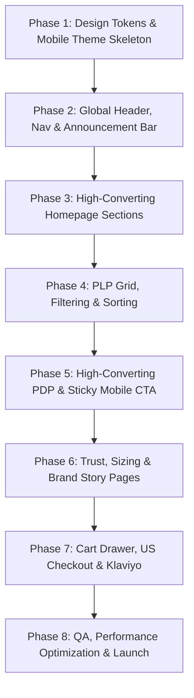

# 💎 IRAYA — Web Development Checklist & Implementation Roadmap
## Premium Indian Silver Jewellery Storefront (US Market / Shopify Architecture)

> **Brand Identity:** **Iraya**  
> **Positioning:** Artisanal, 925 sterling silver Indian handcrafted jewellery for modern US consumers.  
> **Target Audience:** US mobile-first shoppers discovering via Instagram, Pinterest, and TikTok who value ethical craft, heirloom quality, and minimalist luxury.  
> **Tech Architecture:** Shopify Backend (Online Store 2.0 / Liquid / Hydrogen / Headless API) with a high-performance, mobile-optimized frontend.

---

## 📑 Master Navigation & Checklist Index

- [1. Brand Foundations, Design System & Tokens](#1-brand-foundations-design-system--tokens)
- [2. Global Layout & Header System](#2-global-layout--header-system)
- [3. Homepage Architecture (Top-to-Bottom)](#3-homepage-architecture-top-to-bottom)
- [4. Collection & Category Pages (PLP)](#4-collection--category-pages-plp)
- [5. Product Display Page (PDP — Sales Conversion Hub)](#5-product-display-page-pdp--sales-conversion-hub)
- [6. Brand Story, Trust & Pillar Content Pages](#6-brand-story-trust--pillar-content-pages)
- [7. Editorial Journal & SEO Feeder](#7-editorial-journal--seo-feeder)
- [8. Cart Drawer & US Checkout Experience](#8-cart-drawer--us-checkout-experience)
- [9. Technical SEO, Performance & Core Web Vitals](#9-technical-seo-performance--core-web-vitals)
- [10. Third-Party Integrations & Marketing Tech](#10-third-party-integrations--marketing-tech)
- [11. Pre-Launch QA & Device Acceptance Testing](#11-pre-launch-qa--device-acceptance-testing)

---

## 1. Brand Foundations, Design System & Tokens

Aesthetics determine perceived value for fine jewellery. The interface must be restrained, spacious, and let photography carry the emotion without ornamental clutter.

- [ ] **1.1 Design Philosophy & Typography**
  - [ ] Implement primary editorial serif font for headlines and titles (e.g., *Cormorant Garamond*, *Playfair Display*, or *Canela*).
  - [ ] Implement clean, legible modern sans-serif for body, UI labels, sizing, and pricing (e.g., *Inter*, *Plus Jakarta Sans*, or *Outfit*).
  - [ ] Set strict typographical hierarchy with fluid rem-based scaling (`clamp()` for responsive fluid mobile-to-desktop scaling).
  - [ ] Strict rule enforced: No traditional ethnic ornamental vector clutters or cheesy filigree border vectors on the digital UI; craft is conveyed purely through high-definition photography and typography.

- [ ] **1.2 Color Palette & Materiality**
  - [ ] Define **Primary Neutral**: Rich Warm Black / Charcoal (`#121212` or `#1A1918`) for crisp text readability.
  - [ ] Define **Canvas Background**: Soft Warm White / Alabaster (`#FAF8F5` or `#F7F5F0`) to feel warm and organic, avoiding sterile harsh blue-white.
  - [ ] Define **Secondary Accent**: Subtle Muted Antique Gold / Warm Ochre (`#C5A880` or `#BFA175`) for micro-accents and badges.
  - [ ] Define **Silver Tone**: Cool Shimmer Slate (`#E2E4E8` / `#8E929A`) for subtle divider borders and metal indicators.
  - [ ] Define **Functional Colors**: Forest Green (`#1E4D38`) for stock/guarantee badges, Warm Terracotta for subtle alerts.

- [ ] **1.3 Mobile Thumb-Zone Ergonomics**
  - [ ] Set minimum touch target size to 48px × 48px for all mobile interactive buttons and swatches.
  - [ ] Ensure critical actions (Add to Bag, Filter Drawer trigger, Wishlist, Currency switcher) are reachable within the one-handed mobile natural thumb zone.
  - [ ] Position mobile primary CTA as a fixed sticky bottom bar on PDP scroll.

---

## 2. Global Layout & Header System

- [ ] **2.1 US Announcement Bar**
  - [ ] Fixed top thin utility bar with auto-rotating or clean static message.
  - [ ] Primary messaging: *"Free US Shipping over $100 · Duties Included · 30-Day US Returns"*.
  - [ ] US currency selector & shipping country indicator (defaulting to `USD $`).
  - [ ] Mobile height capped at 34px with smooth horizontal ticker/fade transition.

- [ ] **2.2 Top Navigation (5–6 Primary Items)**
  - [ ] Clean desktop navbar:
    1. **Shop** (Triggers curated Mega-Menu)
    2. **Collections** (Curated drop lookbooks & edits)
    3. **Gifts** (Gift guides, sets, ready-to-ship)
    4. **Our Craft** (Heritage, artisan stories, 925 hallmarking)
    5. **Journal** (Editorial styling, craft deep-dives, care tips)
  - [ ] Header utility icons: Search (predictive overlay), Account / Sign-in, Bag with dynamic counter badge.
  - [ ] Sticky header behavior: Shrinks smoothly on scroll-down; reveals on slight scroll-up to preserve screen real estate on mobile.

- [ ] **2.3 Desktop Mega-Menu (Shop Dropdown)**
  - [ ] **Column 1 — By Category:** Earrings, Necklaces & Pendants, Rings, Bracelets & Bangles, Anklets (*Payal*).
  - [ ] **Column 2 — Shop By:** New Arrivals, Bestsellers, Everyday Minimal, Statement & Occasion, Under $100.
  - [ ] **Column 3 — Craft & Technique:** Handcrafted Filigree, Meenakari Enameling, Oxidized Heritage, Jadau Kundan Silver.
  - [ ] **Column 4 — Editorial Spotlight:** Visual promotional card with image, title, and link (e.g., *"The Monsoon Lotus Edit"*).

- [ ] **2.4 Mobile Drawer Navigation**
  - [ ] Smooth slide-out mobile drawer with clean accordion hierarchy.
  - [ ] Direct quick links: Currency (`USD`), Customer Account, Order Tracking, Contact Concierge.
  - [ ] Visual bottom block inside mobile drawer promoting latest collection or US shipping guarantee.

---

## 3. Homepage Architecture (Top-to-Bottom)

Every section must directly address US customer trust, craftsmanship authenticity, and effortless navigation.

- [ ] **3.1 Hero Section (First Impression)**
  - [ ] Full-width editorial hero image or lightweight, muted autoplay looping video (macro craft close-up or on-model shot).
  - [ ] Compelling serif headline (e.g., *"Heirloom Indian Silver, Reimagined for Everyday Modernity"*).
  - [ ] Subheadline emphasizing 925 sterling silver purity, ethical artisan craftsmanship, and US delivery.
  - [ ] Single focused CTA button: **"Shop the Collection"** with subtle micro-hover animation.
  - [ ] Mobile optimization: Native vertical 4:5 / 9:16 aspect ratio asset to avoid awkward center cropping.

- [ ] **3.2 Shop by Category (Curated Tiles)**
  - [ ] 4–5 minimalist visual category tiles (Earrings, Necklaces, Rings, Bracelets, Gifts).
  - [ ] High-contrast editorial photography with clean typography label overlay.
  - [ ] Mobile: Smooth swipeable horizontal carousel with subtle peeking edge to signal scrollability.

- [ ] **3.3 Bestsellers Product Carousel**
  - [ ] Dynamic product grid or carousel featuring top 6–8 US customer favorites.
  - [ ] Product card components:
    - [ ] Image hover swap (Studio flatlay to on-model lifestyle shot).
    - [ ] Clean product title & price in USD.
    - [ ] Star rating with review count (e.g., `★ 4.9 (128)`).
    - [ ] Metal hallmark badge (e.g., `925 Sterling Silver`).
    - [ ] Quick "Add to Bag" or Quick Size Drawer trigger.

- [ ] **3.4 Craft Story Strip (Artisan Spotlight)**
  - [ ] Split layout: Macro photo/video of an artisan at work (e.g., delicate filigree wire twisting or stone setting) + evocative storytelling paragraph.
  - [ ] Specific focus: Origin regions (e.g., Jaipur, Cuttack, Kolhapur), ethical fair wages, and centuries-old metalsmithing traditions.
  - [ ] Direct text CTA: *"Discover Our Craft & Sourcing Standards →"* linking to `/pages/our-craft`.

- [ ] **3.5 Featured Collection (Editorial Lookbook)**
  - [ ] Magazine-style editorial layout highlighting a cohesive seasonal or occasion capsule.
  - [ ] "Shop the Look" interactive hotspots or dual lifestyle-and-product juxtaposed imagery.
  - [ ] Headline, poetic collection description, and direct "Explore Collection" button.

- [ ] **3.6 Gifting Block ("Ships Gift-Ready")**
  - [ ] Focus on gifting for anniversaries, birthdays, weddings, and Diwali.
  - [ ] Showcase premium packaging: Velvet-lined travel pouch, anti-tarnish storage tab, certificate of authenticity, and embossed gift box.
  - [ ] Copy highlighting: *"Every order arrives beautifully boxed and ready to gift with a personalized handwritten note option."*
  - [ ] CTA: **"Shop Curated Gift Sets"** and **"Gifts Under $150"**.

- [ ] **3.7 Trust & US Assurance Bar**
  - [ ] 4-pillar iconography grid built with sleek minimalist vector line-art:
    - [ ] **925 Hallmarked Silver:** Guaranteed purity stamped on every piece.
    - [ ] **Skin Safe & Nickel-Free:** Hypoallergenic for sensitive skin.
    - [ ] **Anti-Tarnish Coating:** Long-lasting e-coat protection.
    - [ ] **Hassle-Free US Returns:** 30-day return window with domestic US return portal.

- [ ] **3.8 Customer Reviews & Press / Social Proof**
  - [ ] Customer photo gallery (UGC) showing pieces worn in real-life casual and festive settings.
  - [ ] Verified buyer quotes with specific praise on weight, shine, US shipping speed, and packaging.
  - [ ] Press logos or editorial quotes (e.g., *"The Indian jewellery label capturing American minimalism"*).

- [ ] **3.9 VIP Email & SMS Signup (Soft Luxury Incentive)**
  - [ ] Non-intrusive elegant signup section.
  - [ ] Value proposition: Early access to limited-edition drops, private archival sales, and artisan stories (avoiding cheap "10% off flash sales" feel).
  - [ ] Micro-copy: *"No spam. Only handcrafted updates and private releases."*

- [ ] **3.10 Global Footer**
  - [ ] Clear categorized columns:
    - [ ] **Customer Care:** Track Order, Shipping & Duties, Returns & Exchanges, Size Guide, Silver Care.
    - [ ] **About Iraya:** Our Story, The Artisans, Sustainability, Hallmarking, Journal.
    - [ ] **Legal & Policies:** Terms of Service, Privacy Policy, Accessibility.
    - [ ] **Stay Connected:** Social icons (Instagram, Pinterest, TikTok), Newsletter box.
  - [ ] Payment badges: Shop Pay, Apple Pay, Google Pay, Visa, Mastercard, Amex, PayPal.
  - [ ] US Domestic Return & Origin statement: *"Designed for the US. Handcrafted with reverence in India."*

---

## 4. Collection & Category Pages (PLP)

- [ ] **4.1 Editorial Header & Context**
  - [ ] Collection title in serif with 2-sentence poetic editorial summary.
  - [ ] Live count of available pieces (e.g., *"24 Handcrafted Designs"*).
  - [ ] Category quick-filter chips (e.g., *Studs · Hoops · Chandbalis · Jhumkas*).

- [ ] **4.2 Filter & Sort Experience**
  - [ ] Mobile slide-up/slide-in filter drawer with count badges.
  - [ ] Essential filter dimensions:
    - [ ] **Category / Sub-type** (Chokers, Layering Chains, Statement Rings, Huggies).
    - [ ] **Style** (Everyday Minimal, Statement, Layered, Bridal/Occasion).
    - [ ] **Craft Technique** (Filigree, Meenakari, Oxidized Silver, Jadau Kundan).
    - [ ] **Price** (Under $75, $75–$150, $150–$300, $300+).
    - [ ] **Finish / Plating** (Pure Silver Polish, Antique Oxidized, 18k Gold Vermeil on 925).
    - [ ] **In Stock / Ready to Ship**.
  - [ ] Sort options: Bestselling, Newest, Price (Low to High, High to Low).

- [ ] **4.3 Responsive Product Grid**
  - [ ] 2-column layout on mobile for optimal visual density without feeling cramped; 3 or 4 columns on desktop.
  - [ ] Image hover interaction: Instant crossfade to on-model scale image on desktop; smooth swipe or tap on mobile.
  - [ ] Badge system: `Bestseller`, `New`, `Limited Drop`, `Few Left`.
  - [ ] Quick-view drawer or inline size selector to add to bag without leaving the grid.
  - [ ] Subtle heart/wishlist button on card corner.

- [ ] **4.4 SEO Content Block (Below Grid)**
  - [ ] 200–300 words of rich, indexable editorial text answering common search queries regarding Indian sterling silver jewelry, styling tips, and purity.
  - [ ] Internal links to complementary collections and the Silver Care Guide.

---

## 5. Product Display Page (PDP — Sales Conversion Hub)

The product page is where US customer skepticism (sizing, metal purity, origin, delivery time) must be completely eliminated.

- [ ] **5.1 Visual Media Gallery (5–8 High-Resolution Assets)**
  - [ ] Image 1: Clean studio product shot on warm neutral background.
  - [ ] Image 2: On-model portrait shot showing scale and styling.
  - [ ] Image 3: Macro close-up showing wirework, gem setting, and 925 hallmark stamp.
  - [ ] Image 4: Scale reference shot (e.g., held in hand or paired next to a ruler/coin).
  - [ ] Image 5: Packaging shot showing velvet pouch and rigid gift box.
  - [ ] Image 6: Short looping video clip showing movement, natural light reflection, and shine.
  - [ ] Mobile layout: Edge-to-edge swipeable carousel with pagination dots and pinch-to-zoom support.

- [ ] **5.2 Product Core Purchase Block**
  - [ ] Breadcrumb navigation: `Home / Shop / Earrings / [Product Title]`.
  - [ ] Title in elegant serif font.
  - [ ] Price in USD with clear duties statement: `"$135 USD — Taxes & Duties Included"`.
  - [ ] Star ratings with jump link to reviews: `★★★★★ 4.9 (42 Reviews)`.
  - [ ] Artisan provenance micro-line: *"Handcrafted in Jaipur by Master Artisan Rajesh Kumar · 14 hours of filigree work"*.

- [ ] **5.3 US Sizing & Customization Selector**
  - [ ] US Ring Sizing (e.g., US 5, 6, 7, 8, 9) or Bracelet Circumference (Inches + CM toggle).
  - [ ] Clean clickable swatch buttons with out-of-stock strike-through.
  - [ ] Prominent link: **"Find Your Size"** opening interactive modal with printable ring sizer and conversion chart.

- [ ] **5.4 Primary CTAs & Sticky Cart Bar**
  - [ ] High-contrast, full-width **"Add to Bag"** button.
  - [ ] Secondary expedited checkout button: **"Buy with Shop Pay"** / **"Apple Pay"**.
  - [ ] **Sticky Mobile Bottom Bar:** Appears when the main Add to Bag button scrolls off-screen, displaying thumbnail, price, size picker, and CTA.

- [ ] **5.5 Delivery & US Confidence Badges**
  - [ ] Real-time estimated delivery calculator: *"Order today, delivers to New York by [Date] with Express US Shipping"*.
  - [ ] Free US Shipping indicator bar.
  - [ ] Gift-wrap option checkbox: *"Add Signature Gift Box & Handwritten Note (+$5.00)"* with note text field.

- [ ] **5.6 Accordion Tabs (Detailed Specifications)**
  - [ ] **Tab 1: Details & Dimensions** (Exact weight in grams, length/width in mm & inches, closure type, clasp mechanism).
  - [ ] **Tab 2: Materials & Hallmarking** (Solid 925 sterling silver, nickel-free, lead-free, hypoallergenic guarantee, anti-tarnish e-coating).
  - [ ] **Tab 3: The Artisan & Craft** (Regional technique breakdown, cultural symbolism, ethical craft verification).
  - [ ] **Tab 4: Care Instructions** (Storage tips, avoiding moisture/perfume, polishing cloth instructions).
  - [ ] **Tab 5: US Shipping, Duties & Returns** (Free shipping threshold, 30-day domestic US returns address, zero surprise customs fees).

- [ ] **5.7 Cross-Sell Modules**
  - [ ] **"Pairs Well With"** (Complementary item bundle, e.g., matching necklace for earrings with 1-click bundle discount).
  - [ ] **"Complete the Look"** (Full editorial set recommendation).

- [ ] **5.8 Verified Reviews & Photo Gallery**
  - [ ] Review rating breakdown bar (5-star distribution).
  - [ ] Customer photo/video review carousel.
  - [ ] Search & filter reviews by verified US buyers, fit, and rating.

---

## 6. Brand Story, Trust & Pillar Content Pages

- [ ] **6.1 Our Craft & Heritage Story (`/pages/our-craft`)**
  - [ ] The Iraya ethos: Connecting centuries-old Indian artisan lineages with modern global aesthetics.
  - [ ] Interactive technique guide: Filigree (*Tarakasi*), Enameling (*Meenakari*), Oxidized temple craft, Jadau gemstone setting.
  - [ ] Fair trade and ethical artisan partnership commitments: Transparent wages, safe workshops, craft preservation.
  - [ ] Hallmarking standard breakdown: What 925 means, purity testing, assay certification.

- [ ] **6.2 Silver Care Guide (`/pages/care-guide`)**
  - [ ] High-ranking SEO page addressing: *"How to clean oxidized silver"*, *"Preventing silver tarnish"*, *"Storing fine jewelry"*.
  - [ ] Step-by-step cleaning instructions with visual micro-illustrations.
  - [ ] Dos & Don'ts (perfume, swimming, lotions).
  - [ ] Direct product link to purchase Iraya Silver Polishing Cloth & Storage Pouches.

- [ ] **6.3 US Size & Measurement Guide (`/pages/size-guide`)**
  - [ ] International-to-US ring size conversion chart (US, UK, European, Indian).
  - [ ] Step-by-step measurement guide (paper strip method + existing ring diameter).
  - [ ] Downloadable 1:1 scale printable PDF ring sizer for US letter format.
  - [ ] Bracelet & bangle circumference guide (measuring knuckles vs. wrist).
  - [ ] Necklace chain length visualizer (16" choker vs 18" collar vs 24" opera on model collarbone).

- [ ] **6.4 Shipping, US Returns & Customs Duties (`/pages/shipping-returns`)**
  - [ ] Transparent domestic US fulfillment & international courier timeline (DHL Express / FedEx Priority).
  - [ ] Clear statement: *"All prices are displayed in USD. All import duties, tariffs, and taxes are 100% pre-paid by Iraya — guaranteed no surprise delivery fees."*
  - [ ] 30-Day US Return Policy with step-by-step return portal instructions and US return address.

- [ ] **6.5 FAQ & Customer Concierge (`/pages/faq`)**
  - [ ] Categorized accordion: Metal purity, sensitive ears/skin, gifting, shipping speed, custom sizing, repairs.
  - [ ] Live chat trigger / WhatsApp concierge / Email contact form with guaranteed 24-hour response window.

---

## 7. Editorial Journal & SEO Feeder

- [ ] **7.1 Journal Hub (`/blogs/journal`)**
  - [ ] Magazine layout featuring rich photography, author bylines, and read time.
  - [ ] Category tabs: *Styling Guides*, *Craft Stories*, *Wedding & Festive Edits*, *Care Tips*.

- [ ] **7.2 Core SEO Content Calendar Articles**
  - [ ] *"How to Style Statement Indian Silver with Western Everyday Wear"*
  - [ ] *"The Modern Guide to 925 Sterling Silver vs. Silver Plated Jewelry"*
  - [ ] *"Understanding Meenakari: The Ancient Art of Indian Enameling"*
  - [ ] *"The Ultimate Indian Jewelry Gift Guide: From Minimalist Studs to Heirlooms"*
  - [ ] *"Diwali & Wedding Guest Styling: Effortless Silver Looks"*

- [ ] **7.3 Shoppable Blog Posts**
  - [ ] In-article embedded shoppable product cards with instant "Add to Bag".
  - [ ] Pinterest "Pin It" hover button on all editorial imagery.

---

## 8. Cart Drawer & US Checkout Experience

- [ ] **8.1 Slide-Out AJAX Cart Drawer**
  - [ ] Dynamic free shipping progress bar: *"You're only $25 away from Free US Shipping!"*.
  - [ ] Line item details: Product thumbnail, title, metal/size variant, quantity selector, price in USD.
  - [ ] In-cart gift wrap & personal message toggle.
  - [ ] One-click cross-sell carousel inside cart drawer: *"Complete your set: Add Silver Polishing Cloth (+$12)"*.
  - [ ] Security reassurance icons: 256-bit encrypted checkout, 30-day money-back guarantee.

- [ ] **8.2 Frictionless US Checkout Flow**
  - [ ] Native 1-click accelerated checkouts: **Shop Pay**, **Apple Pay**, **Google Pay**, **PayPal**.
  - [ ] Guest checkout enabled by default (no forced account creation before purchase).
  - [ ] Address autocompletion (Google Places API / Shopify native address verification) formatted for US states and ZIP codes.
  - [ ] Clear delivery options: Standard Ground (3–5 business days) vs. Expedited Priority (2 business days).

- [ ] **8.3 Post-Purchase & Tracking**
  - [ ] Branded order confirmation page with delivery map and estimated arrival dates.
  - [ ] Instant automated order confirmation email with itemized receipt and care guide download.
  - [ ] Real-time package tracking page integration (e.g., Route, Wonderment, or Shopify Shop App).

---

## 9. Technical SEO, Performance & Core Web Vitals

US mobile shoppers bounce quickly if page load exceeds 3 seconds. High performance is a non-negotiable conversion factor.

- [ ] **9.1 Core Web Vitals Benchmarks**
  - [ ] **Largest Contentful Paint (LCP):** < 2.2s on mobile 4G networks.
  - [ ] **Interaction to Next Paint (INP):** < 200ms.
  - [ ] **Cumulative Layout Shift (CLS):** < 0.05.
  - [ ] Overall Mobile PageSpeed score target: **90+**.

- [ ] **9.2 Media & Asset Optimization**
  - [ ] Convert all photography to next-gen formats (`.webp` and `.avif`) with responsive `srcset` and `sizes` attributes.
  - [ ] Lazy load all below-the-fold media with CSS blur-up or skeleton placeholder.
  - [ ] Preload hero LCP image with `<link rel="preload" as="image">` and `fetchpriority="high"`.
  - [ ] Self-host critical web fonts with `font-display: swap` to prevent FOIT (Flash of Invisible Text).

- [ ] **9.3 Structured Data & Rich Snippets (JSON-LD)**
  - [ ] Product Schema markup (`Product`, `Offer`, `AggregateRating`, `Brand`, `Review`).
  - [ ] BreadcrumbList Schema on collection and product pages.
  - [ ] Organization & LocalBusiness Schema with US customer support details and founder backstory.
  - [ ] FAQPage Schema on FAQ and Care Guide pages for Google search SERP accordion expanders.

- [ ] **9.4 Metadata & Social Graph**
  - [ ] Custom OpenGraph (`og:image`, `og:title`, `og:description`) and Twitter Card tags optimized for Pinterest and iMessage link previews.
  - [ ] Clean canonical URLs across all parameterized filter pages to prevent duplicate content penalties.

---

## 10. Third-Party Integrations & Marketing Tech

- [ ] **10.1 Email & SMS Lifecycle (Klaviyo Integration)**
  - [ ] Welcome Series (Brand story, artisan origins, US shipping perks).
  - [ ] Abandoned Cart & Abandoned Checkout flows with dynamic product images and single-click recovery URL.
  - [ ] Browse Abandonment flow (for visitors who viewed PDPs but didn't add to cart).
  - [ ] Post-purchase Care & Review generation sequence (triggered 7 days after delivery).
  - [ ] Back-in-Stock & Restock notification capture.

- [ ] **10.2 Analytics, Pixels & Conversion Tracking**
  - [ ] Google Analytics 4 (GA4) configured with enhanced ecommerce event tracking (`view_item`, `add_to_cart`, `begin_checkout`, `purchase`).
  - [ ] Meta Pixel & Conversions API (CAPI) for high-intent Instagram/Facebook ads.
  - [ ] Pinterest Tag with enhanced match for jewellery styling pin discovery.
  - [ ] TikTok Pixel for short-form video craft storytelling campaigns.

- [ ] **10.3 Customer Reviews & Social Proof App**
  - [ ] Setup Judge.me, Okendo, or Yotpo with automated photo review collection emails.
  - [ ] Custom CSS styling to blend the review widget seamlessly into the restrained, serif-led design system.

- [ ] **10.4 Customer Support & Concierge**
  - [ ] Gorgias or Shopify Inbox integrated with automated quick-answers for US shipping times, ring sizing, and metal purity questions.

---

## 11. Pre-Launch QA & Device Acceptance Testing

- [ ] **11.1 Cross-Device & Mobile Browser Testing**
  - [ ] Test on real iOS devices (Safari on iPhone 12/13/14/15/16 Pro and standard models).
  - [ ] Test on real Android devices (Chrome on Samsung Galaxy, Google Pixel).
  - [ ] Validate touch ergonomics: sticky Add to Bag bar does not collide with iOS Safari home bar or floating action buttons.
  - [ ] Verify pinch-to-zoom on product imagery works smoothly without breaking page scrolling.

- [ ] **11.2 End-to-End Test Transactions**
  - [ ] Execute real test order using test credit card and Shop Pay.
  - [ ] Validate calculation of US state sales taxes (Shopify Tax / Avalara).
  - [ ] Verify free shipping threshold logic ($100+ activates free shipping option automatically).
  - [ ] Validate gift wrap checkbox fee correctly adds to cart subtotal.
  - [ ] Verify gift message renders properly in the admin order notes and packing slips.

- [ ] **11.3 Security, Accessibility & Compliance**
  - [ ] WCAG 2.1 AA accessibility compliance (color contrast ratios >= 4.5:1 for body copy).
  - [ ] Screen-reader accessible labels on all icon-only buttons (Close drawer, Bag, Search, Wishlist).
  - [ ] US privacy compliance (CCPA / CPRA privacy notice and cookie preference banner if required).

---

## 🚀 Execution Phasing & Next Steps

> **Ready to Build:** To proceed with wireframing, creating the Liquid/HTML/CSS components, or writing specific page copy, refer to each numbered item above as the single source of acceptance criteria.
